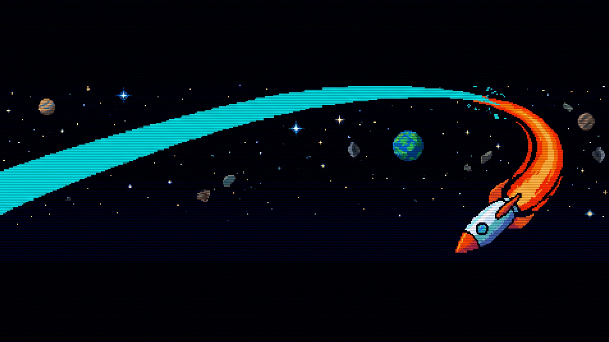
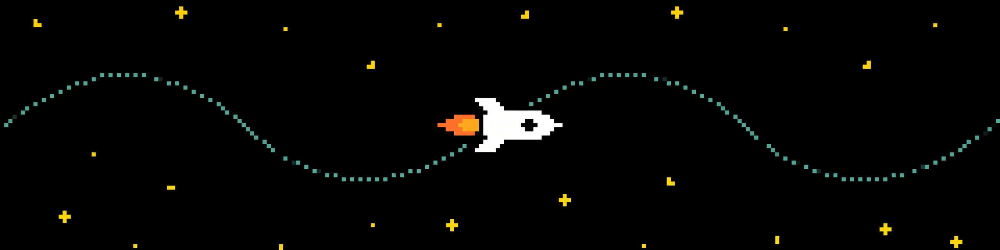
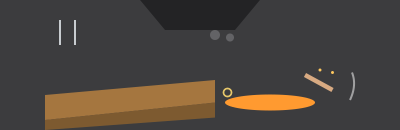

# Fun-Script-Animation

<p align="center"></p>



A terminal animation: a rocket flies back and forth across a field of 50 stars, bobbing on a sine wave, while the cursor is hidden for the duration of the show.


## Run

```
bash animation.sh
```

Stop with Ctrl+C. The script restores the cursor on exit.


## Requirements

A terminal, `tput`, and `bc`. If `tput` cannot report a terminal size, the script falls back to 80 columns by 24 rows instead of dividing by zero.


## Verified behaviour and fixes

Verified under a stub `tput`/`bc` harness with a timed run: the animation draws stars and the rocket, and after an interrupt the stub log shows `cnorm`, proving the cursor is restored. Before this pass the cursor-restore trap sat after an infinite loop, so it could never run and Ctrl+C left the cursor hidden. Star and rocket positions are now 1-based (terminals number rows and columns from 1), and the rocket bounces at column 1 instead of column 0. The script was not run on a real terminal display in this pass, so colours and pacing are as coded, not watched live.

Files: `animation.sh`, `logo.png`, `banner.png`.
